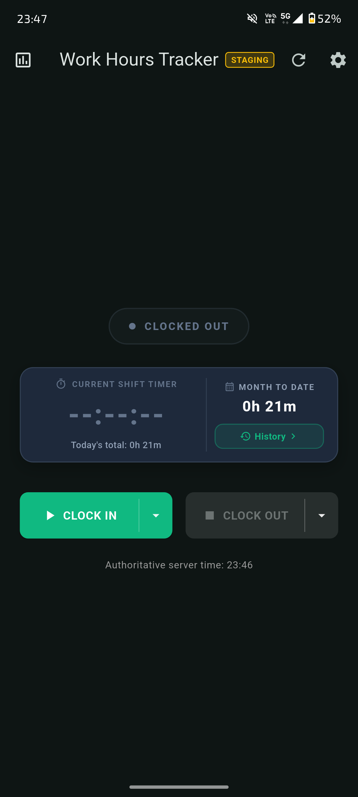
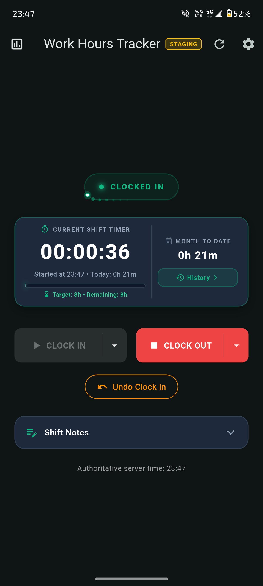
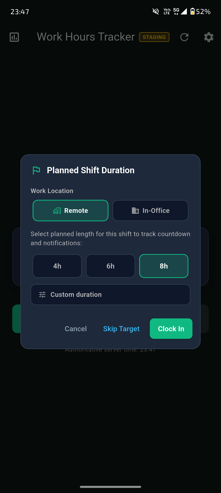
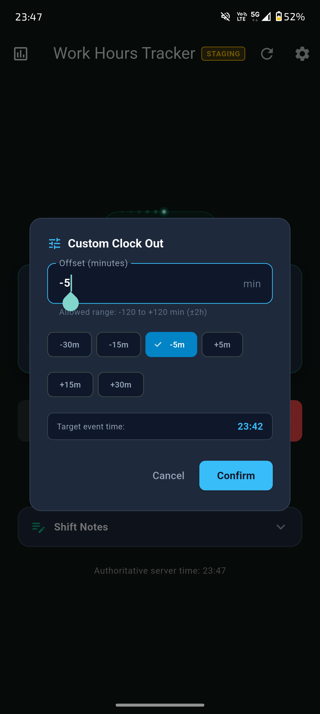
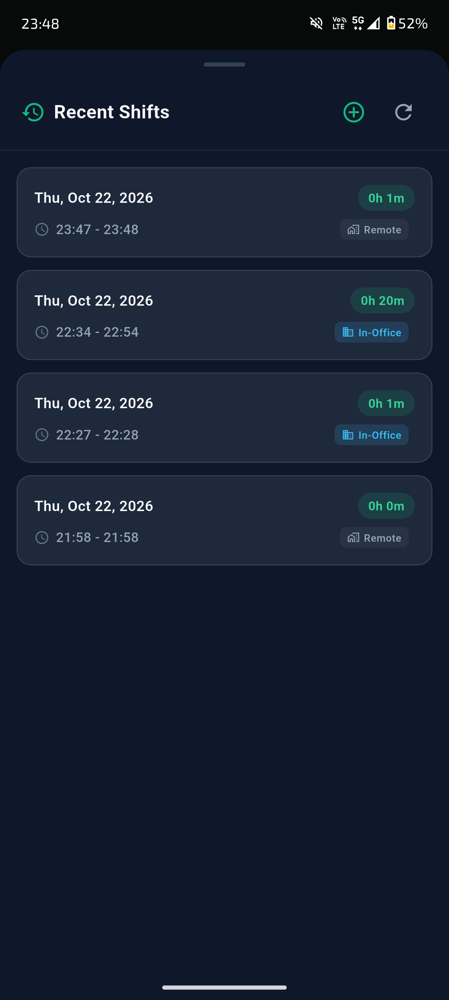
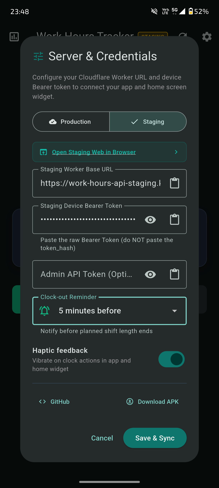
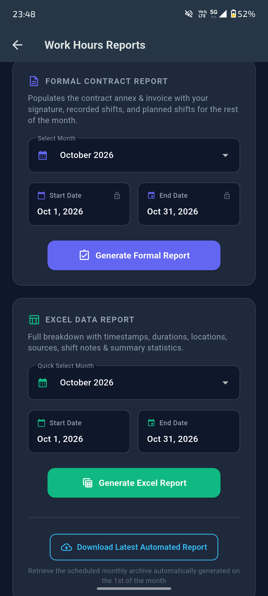

# Work Hours Tracker

A low-friction, single-user work hours tracking platform with authoritative server time, Cloudflare D1 SQLite persistence, automated Cloudflare R2 Excel reporting, a shared Flutter client (Android & responsive Web), and an independent native Android home-screen widget.

---

## Project Status

- **Current Version:** `v1.2.2` (see [CHANGELOG.md](CHANGELOG.md))
- **Status:** Personal production, actively used
- **Supported Platforms:** Android (App + Native Widget), Web (Desktop/Mobile browser), Cloudflare Workers (Backend + Static Assets)

---

## Screenshots & Visual Overview

| Main Dashboard (Clocked Out) | Active Shift (Clocked In) |
| :---: | :---: |
|  |  |

| Shift Duration & Location | Custom Time Offsets |
| :---: | :---: |
|  |  |

| Recent Shifts & History | Multi-Environment Settings |
| :---: | :---: |
|  |  |

### Side-by-Side Reports Dashboard (Formal Contract & Full Excel)


---

## Documentation Directory

Detailed specifications, runbooks, and contracts have been separated into dedicated documents:

- **[DESIGN.md](DESIGN.md):** Ground-truth architectural specification, state machine invariants, and data models.
- **[ROADMAP.md](ROADMAP.md):** Active hardening roadmap, audit findings, and future feature milestones.
- **[docs/API.md](docs/API.md):** Complete `/api/v1/*` endpoint schemas, headers, error codes, and request examples.
- **[docs/DEPLOYMENT.md](docs/DEPLOYMENT.md):** Infrastructure setup, D1 migrations, R2 buckets, device provisioning, and backup runbooks.
- **[CHANGELOG.md](CHANGELOG.md):** Release history and version notes following Keep a Changelog.

---

## System Architecture

```text
       +---------------------------------------------+
       |         Android Home-Screen Widget          |
       |             (Kotlin / RemoteViews)          |
       +----------------------+----------------------+
                              |
                              | HTTPS JSON API (Bearer Device Token)
                              v
+-----------------------------+-----------------------------+
|                 Flutter App (Mobile & Web)                |
|             (Riverpod State / Dark Modern UI)             |
+-----------------------------+-----------------------------+
                              |
                              | HTTPS JSON API (Device / Admin Token)
                              v
+-----------------------------------------------------------+
|               Unified Cloudflare Worker                   |
|   - Serves /api/v1/* and Flutter Web (Workers Assets)     |
|   - Multi-Environment Support (Production & Staging)      |
|   - SHA-256 Hashed Device Auth & Idempotency Engine       |
|   - 5-Minute Undo Grace Window & State Machine Engine     |
|   - Pure TS OpenXML Generators (.xlsx / .docx) & R2       |
|   - Scheduled Monthly Cron Dispatcher (0 0 1 * *)         |
+----------------------+----------------------+-------------+
                       |                      |
                       v                      v
          +-----------------------+ +--------------------+
          |     Cloudflare D1     | |   Cloudflare R2    |
          |  (work-hours-prod/    | |(work-hours-reports/|
          |   work-hours-staging) | |      -staging)     |
          +-----------------------+ +--------------------+
```

---

## Core Guarantees & Features

### Authoritative Server Time & State Engine
- **Server Authority:** The server generates all authoritative timestamps in UTC ISO 8601. Client clocks are never trusted for state transitions.
- **Minute-Precision Shift Accounting:** Shift start/end timestamps (`occurred_at_utc`, `active_since_utc`) and all derived durations are normalized to minute precision (`YYYY-MM-DDTHH:MM:00.000Z`), ensuring displayed `HH:mm` shift bounds, shift badges, daily/monthly totals, and Excel reports are always identical.
- **Explicit Transitions:** Separate `POST /api/v1/clock-in` and `POST /api/v1/clock-out` endpoints prevent toggle race conditions.
- **Time Offset Support:** Clock actions support retroactive or anticipated adjustments (`offsetMinutes: -5` or `+5`) for accurate timekeeping when clocking slightly late or early.
- **Strict Idempotency:** Duplicate or replayed network requests with the same `requestId` return cached results without inserting duplicate events.
- **Warsaw Timezone:** Daily boundaries, active shift pairing, and month-to-date durations are computed in `Europe/Warsaw` across daylight saving transitions.
- **Undo Grace Window:** Accidental clock actions can be atomically reverted via `POST /api/v1/undo`.

### Unified Edge Backend & Environments
- **Single Worker Deployment:** Serves both `/api/v1/*` JSON endpoints and Flutter Web static assets (`app/build/web`) via Cloudflare Workers Static Assets (`run_worker_first: true`).
- **Production & Staging Isolation:** Dedicated Wrangler environments isolate production (`work-hours-prod` D1, `work-hours-reports` R2) from staging (`work-hours-staging` D1, `work-hours-reports-staging` R2).
- **Timing-Safe Device Auth:** Bearer tokens are hashed with a server-side pepper (`DEVICE_TOKEN_PEPPER`) and verified against D1 `devices.token_hash` using timing-safe comparisons.

### Flutter Client (Android & Responsive Web)
- **Shared Codebase:** Riverpod state management, domain models, and API clients are 100% shared across mobile and browser.
- **Planned Shift Lengths & Progress Ring:** Clock in with planned duration pills (4h, 6h, 8h, or custom), displaying a glowing animated progress bar, countdown timer, and overtime indicator.
- **Shift End Reminders:** Configurable notifications (5m, 10m, 15m lead times) scheduled natively via Android `AlarmManager` and HTML5 Web Notification API.
- **Environment Switcher:** In-app server settings dialog allows seamless switching between Production and Staging with fully isolated secure storage and locked, non-editable API base URLs.
- **Responsive 4-Quadrant Desktop View:** Viewports `>= 900px` render Current Tracker, Note Editor, Markdown Preview, and Recent Shifts side-by-side. Clicking past shifts loads their notes directly for retroactive viewing/editing, with auto-drafting and dual-save clock-out protection.
- **Shift Notes & Inline Editing:** Markdown-capable notes editor with live preview, autosaved drafts, and retroactive editing for past shifts.
- **Historical Backfill:** Admin dialog to record missed past shifts with date/time pickers and overlap validation.

### Native Android Home-Screen Widget
- **Independent API Client:** The Kotlin widget communicates directly with the Worker API via OkHttp without requiring the Flutter engine to run.
- **Current-State Display:** Displays the last synchronized status, active-since timestamp, and last-sync time.
- **Signaling Bridge:** In-app clock operations request an immediate widget refresh via Android `MethodChannel`, but the widget reconciles independently on every action.

### OpenXML Reporting & Cloudflare R2
- **Dual Worker-Compatible Generators:** Pure TypeScript OpenXML builders generating both multi-sheet Excel spreadsheets (`.xlsx`) and formal contract attendance attachments (`.docx` with embedded handwritten signatures, automated table generation, and `Rachunek do umowy zlecenia` aggregation) directly inside V8 isolate memory.
- **Simultaneous Side-by-Side Reports Dashboard:** Dedicated reports interface displaying Formal Contract and Excel Data report cards side-by-side, complete with future shift projection planning (`PlanFutureShiftsDialog`), live `Recorded + Planned = Projected Total` calculations, and automatic R2 storage discovery on load.
- **Automated Monthly Cron:** Fires at midnight UTC on the 1st of every month, generating full workbooks for the previous calendar month in `Europe/Warsaw` boundaries and archiving them to Cloudflare R2 (`work-hours-reports`).
- **Sanitized Downloads:** On-demand report downloads stream directly through the API with strict filename regex validation and formula injection defenses.

---

## Technology Stack

| Component | Technology | Rationale |
| :--- | :--- | :--- |
| **Backend & Routing** | Cloudflare Workers (TypeScript) | Globally distributed, sub-millisecond cold starts, native cron triggers |
| **Database** | Cloudflare D1 (SQLite) | Relational edge storage with ACID batch transactions |
| **Object Storage** | Cloudflare R2 | S3-compatible, zero-egress-fee report archive |
| **Web Frontend** | Flutter Web + Workers Static Assets | Co-located on the same domain with SPA route fallback |
| **Mobile Client** | Flutter (Dart 3.5+) + Riverpod | Cross-platform state management with unified API contracts |
| **Android Widget** | Kotlin + Android RemoteViews | Lightweight native widget operating independently without Flutter runtime |
| **Notifications** | Android AlarmManager + BroadcastReceiver | Reliable background shift alarms that wake the device |
| **Report Engine** | Pure TypeScript OpenXML (.xlsx) | Runs natively in Workers isolates without Node.js filesystem APIs |

---

## Repository Layout

```text
work-hours-tracker/
├── app/                       # Flutter client (Android & Web)
│   ├── android/               # Native Android host, widget receiver, and FileProvider
│   ├── lib/                   # Shared Dart codebase (Riverpod, API, Features)
│   ├── web/                   # Web host template and assets
│   └── test/                  # Unit and widget test suites
├── worker/                    # Cloudflare Worker backend
│   ├── src/                   # TypeScript API router, auth, clock engine, reports
│   │   └── reports/           # Pure TS OpenXML generator and R2 service
│   ├── migrations/            # D1 SQLite migrations
│   ├── scripts/               # Device provisioning scripts
│   ├── test/                  # Vitest unit and integration test suites
│   └── wrangler.jsonc         # Wrangler config, D1, R2, and Cron triggers
├── docs/                      # Modular technical documentation
│   ├── API.md                 # Complete API contract and error reference
│   └── DEPLOYMENT.md          # Setup, migrations, provisioning, and backup runbook
├── CHANGELOG.md               # Version history and milestone tracking
├── DESIGN.md                  # Ground-truth architectural invariants
├── ROADMAP.md                 # Active hardening specification and roadmap
└── README.md                  # Project overview and navigation
```

---

## Quick Start & Mandatory Verification

Before deploying or pushing changes to remote, both `npm run typecheck` and `flutter analyze` must pass with zero errors and zero warnings:

### Worker Verification
```bash
# Typecheck and run backend test suite (mandatory before deploy)
npm --prefix worker run typecheck
npm --prefix worker test
```

### App Verification
```bash
# Analyze and run client test suite (mandatory before deploy)
cd app
flutter analyze
flutter test
```

For full deployment, D1 migration, R2 setup, and device provisioning instructions, refer to **[docs/DEPLOYMENT.md](docs/DEPLOYMENT.md)**.

---

## Explicit Non-Goals

To maintain a fast, reliable personal tool with minimal maintenance:
- **No Complex Offline SQLite Outbox:** The server is the single source of truth; network operations require connectivity.
- **No Multi-Tenant / Team Features:** Single-user focus keeps the security and data model simple and rock-solid.
- **No Location / GPS Tracking:** Privacy-focused; manual source attribution (`flutter_app`, `android_widget`, etc.) is sufficient.
- **No Real-Time Sockets / Continuous Polling:** Periodic lifecycle refreshes and pull-to-refresh eliminate unnecessary battery drain.