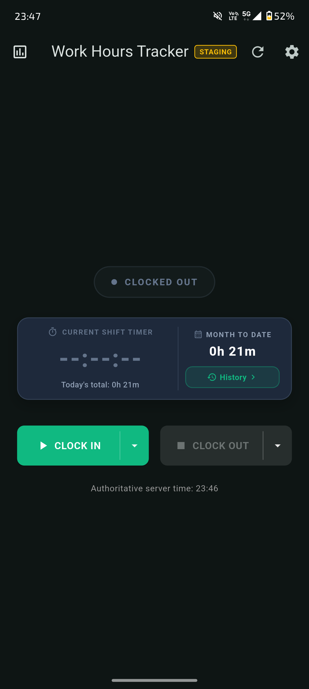
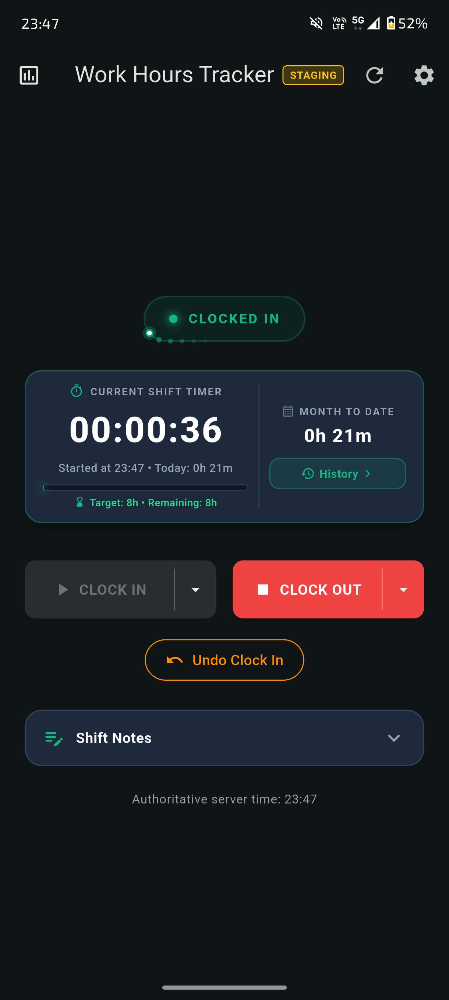
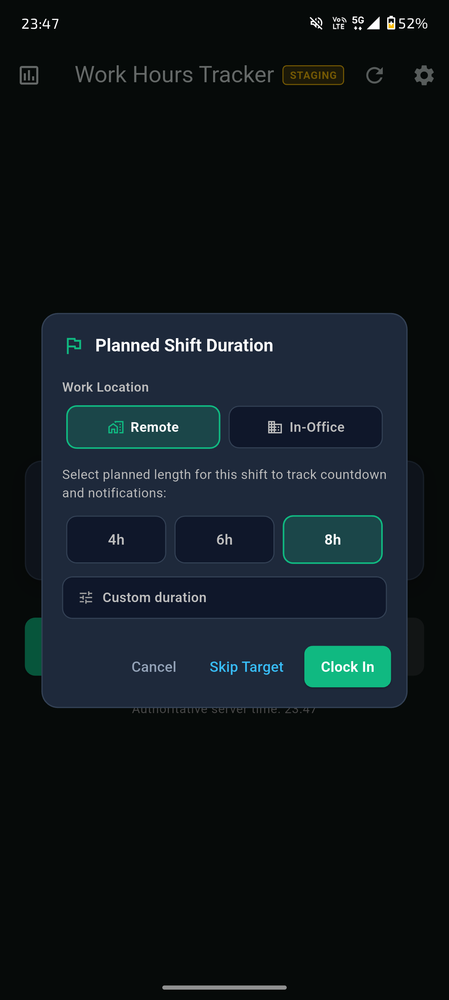
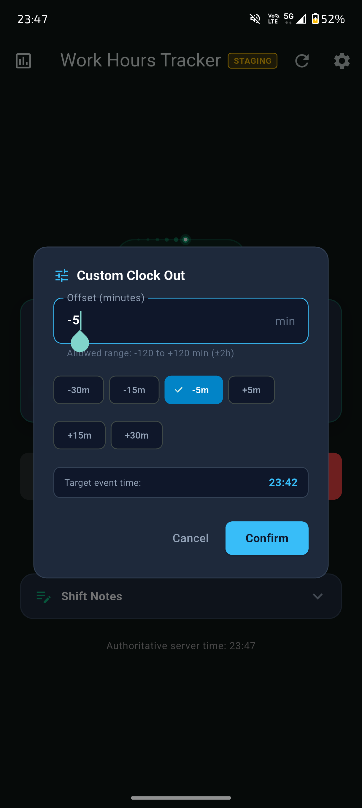
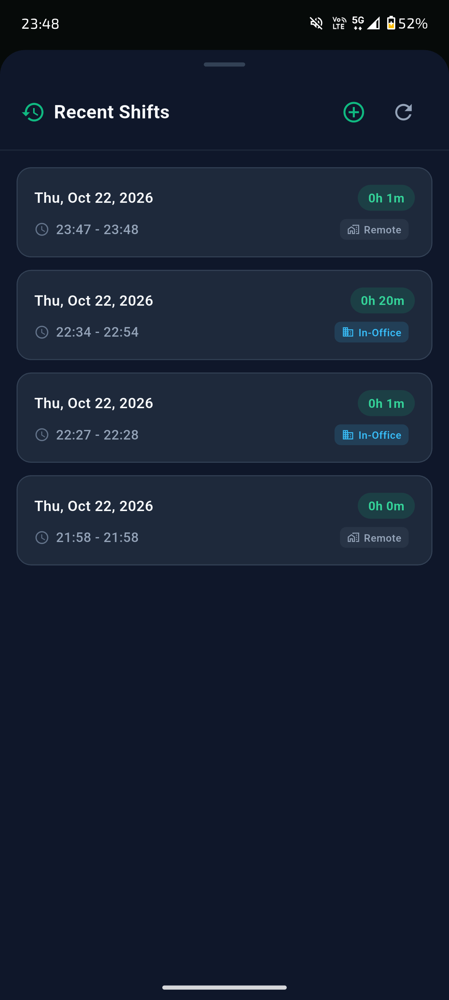
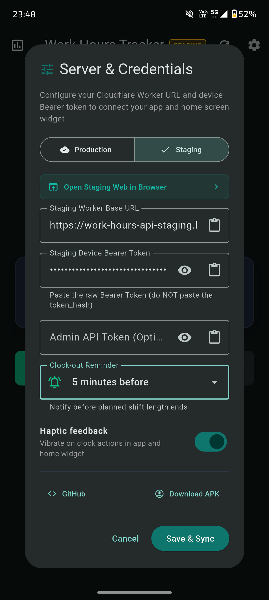

# Work Hours Tracker

Single-user work hours tracking system (`v1.3.2`) with a **Flutter** client (Android + Web + native Android home-screen widget) and a **Cloudflare Worker** API backed by **D1**, **R2**, and pure-TypeScript `.xlsx` / `.docx` OpenXML report generators.

## Repository Layout

- `app/` — Flutter client (`flutter_riverpod`, Android + Web)
- `worker/` — Cloudflare Worker API, D1 migrations, R2 report generators, and Vitest suite
- `bruno/` — Bruno API collection
- `screenshots/` — App UI screenshots

## Contract Profile Example

Example schema for private R2 contract metadata (`templates/contract-profile.json`):

```json
{
  "contractorName": "Jan Kowalski",
  "contractDate": "01.01.2026",
  "hourlyRatePln": 50,
  "monthlyHours": 80,
  "grossAmountPln": 4000,
  "issuePlace": "Wrocław"
}
```

## Verification

```bash
# Worker
cd worker && npm run typecheck && npm test

# Flutter
cd app && flutter analyze && flutter test
```

## Screenshots

| Main Dashboard (Clocked Out) | Active Shift (Clocked In) |
| :---: | :---: |
|  |  |

| Shift Duration & Location | Custom Time Offsets |
| :---: | :---: |
|  |  |

| Recent Shifts & History | Multi-Environment Settings |
| :---: | :---: |
|  |  |
